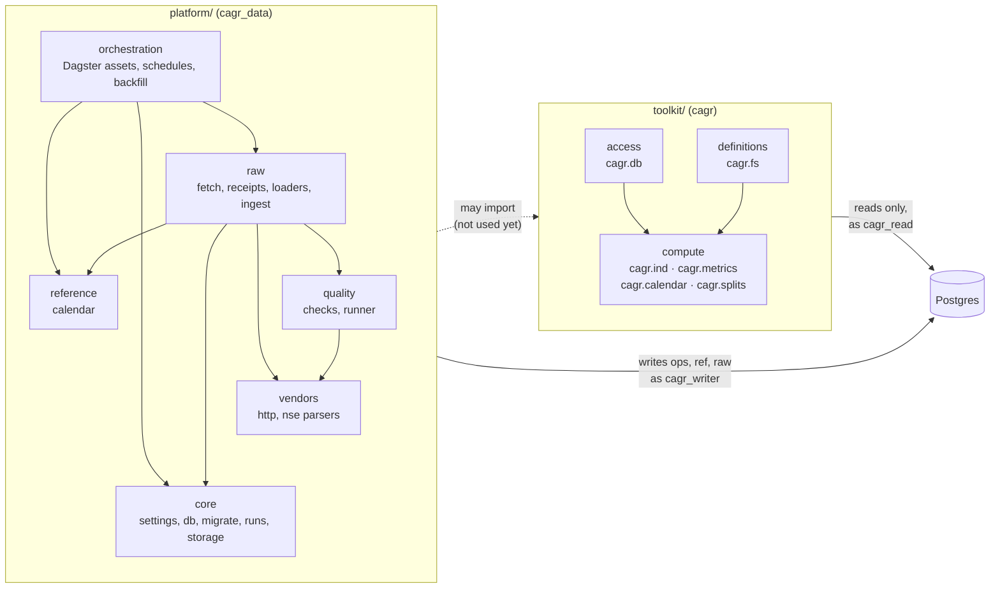
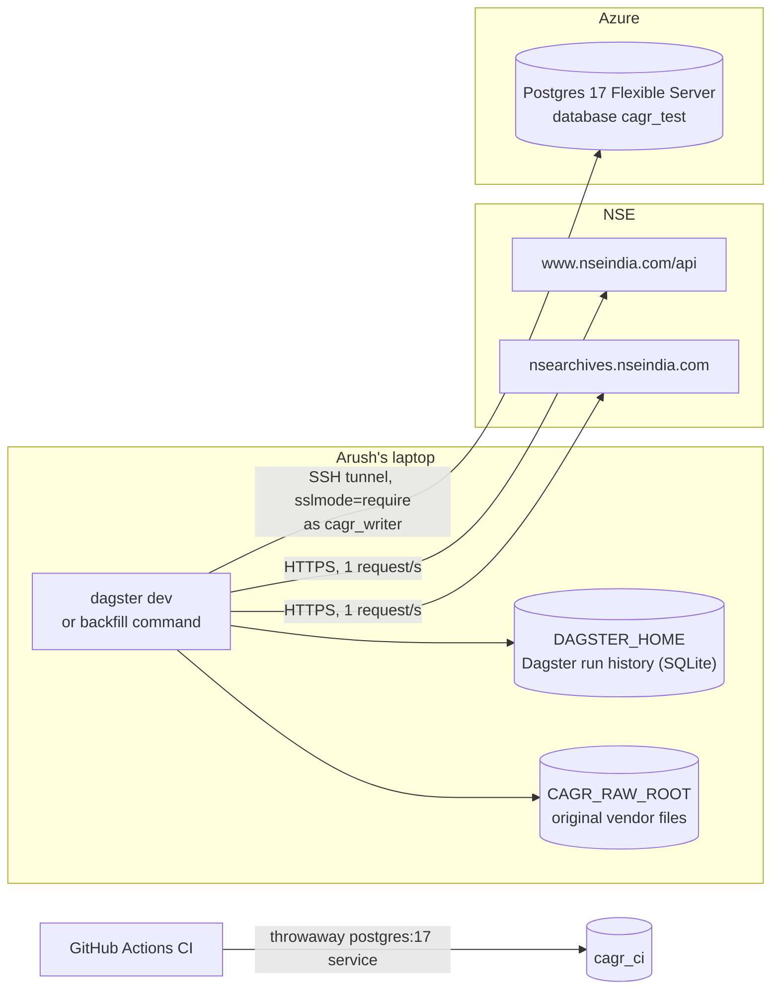

# Architecture overview

The repository is one monorepo, managed as a [uv](https://docs.astral.sh/uv/) workspace on
Python 3.12. Today it holds two Python packages, a folder of SQL migrations, and CI.

## Repository layout

```text
cagr-data-platform/
├── pyproject.toml            workspace root: members platform/ and toolkit/, ruff, mypy, pytest
├── uv.lock                   locked dependency versions for the whole workspace
├── db/migrations/            0001..0006 SQL migrations, applied in order by yoyo
├── platform/                 package cagr-data, imported as cagr_data
│   ├── src/cagr_data/
│   │   ├── core/             settings, connections, migrations, ops.run, file storage
│   │   ├── vendors/          HTTP client, errors, and NSE URL builders and parsers
│   │   ├── raw/              feeds, fetch, receipts, COPY loaders, ingest
│   │   ├── quality/          raw-layer checks and the runner that records them
│   │   ├── reference/        XNSE trading calendar
│   │   └── orchestration/    Dagster assets, schedules, resources, backfill command
│   └── tests/                unit/ (no database) and db/ (needs Postgres), fixtures/nse/
├── toolkit/                  package cagr-toolkit, imported as cagr
│   ├── src/cagr/             ind, metrics, calendar, splits, fs, db
│   └── tests/
├── docs/                     this documentation, plus specs/
└── .github/workflows/ci.yml  lint, format, type-check and test on every PR and push to main
```

## The two packages

| Package | Import name | Version | Role | Key dependencies |
|---|---|---|---|---|
| `cagr-data` | `cagr_data` | 0.1.0 | The data platform: fetches vendor files, stores them, loads rows, runs checks, builds the calendar | psycopg 3, Polars, httpx, tenacity, Dagster, yoyo-migrations, pydantic-settings |
| `cagr-toolkit` | `cagr` | 0.1.0 | The shared library every component imports: indicators, metrics, session arithmetic, splits, feature declarations, read-only DB access | Polars, psycopg 3, pydantic-settings |

The rule between them is one-way: **the toolkit never imports `cagr_data`**. A test
(`toolkit/tests/test_cagr_layers.py`) reads every toolkit source file and fails if it does.



Arrows point from the importer to what it imports. The platform is allowed to import the toolkit
(the dotted arrow) but does not yet; the toolkit may never import the platform.

## Platform modules

| Module | What it does |
|---|---|
| `core.settings` | `Settings` reads `CAGR_DATABASE_URL` and `CAGR_RAW_ROOT` from the environment or `.env`. |
| `core.db` | `connect(url)` opens a psycopg 3 connection; with no url it uses `CAGR_DATABASE_URL`. |
| `core.migrate` | Applies `db/migrations` with yoyo; yoyo's bookkeeping lives in schema `yoyo`. |
| `core.runs` | `start_run` / `finish_run` write `ops.run`. |
| `core.storage` | The `Storage` protocol, `LocalStorage` (write-once files under a folder) and `raw_key`. |
| `vendors.http` | `VendorClient`: one polite HTTP client with a per-host rate limiter and retries. |
| `vendors.errors` | `VendorFileError`, `FileShapeError`, `TradeDateMismatchError`. |
| `vendors.nse.*` | `build_url` and one parser per NSE file format (bhavcopy, index close, holidays, listings). |
| `raw.feeds` | `Feed` (a `raw.feed` row) and `FORMATS`: format name → parser and target table. |
| `raw.fetch` | `fetch_and_ingest`: skip if received, GET, log the attempt, ingest. |
| `raw.receipts` | `record_attempt` and `receive` (dedupe by sha256, revisions, write `raw.vendor_file`). |
| `raw.loaders` | `load_rows` (COPY into a raw table) and `analyze`. |
| `raw.ingest` | `ingest_file` (parse → receipt → rows → checks) and `check_arrived`. |
| `quality.checks` | The checks as pure functions returning `Outcome`s. |
| `quality.runner` | `load_checks`, `record` (writes `ops.dq_result`), `raise_on_critical`. |
| `reference.calendar` | Builds and stores the XNSE calendar from the weekend rule and exceptions. |
| `orchestration.*` | Dagster assets, jobs, schedules, resources, and the backfill command. |

## Where things run today



- The pipeline runs on Arush's laptop, against the `cagr_test` database. Production `stockdb` is
  not touched by anything in this repository.
- Original files are kept in a local folder (`CAGR_RAW_ROOT`). The code only sees the `Storage`
  protocol, so a blob store can replace the folder with one new class.
- Dagster keeps its own run history in `DAGSTER_HOME` (SQLite), never in the platform database.
- CI builds a fresh Postgres 17 container per run; the platform's tests create their own database
  inside it.

## Database roles

Three logins, each with one job. The migrations grant exactly what each needs (details in
[Database](../data-model/database.md#roles-and-privileges)).

| Role | Used by | Setting | Can |
|---|---|---|---|
| `cagr_platform` | Migrations | `CAGR_DATABASE_URL` | Own and change every schema |
| `cagr_writer` | Dagster pipeline | `CAGR_PIPELINE_DATABASE_URL` | Insert into `raw`, write runs, results and the calendar |
| `cagr_read` | Toolkit (`cagr.db`) | `CAGR_READ_DATABASE_URL` | Read everything |

## Design rules visible in the code

- **Raw is append-only.** The writer can only `INSERT` into `raw` tables; changed vendor bytes
  become a new revision, never an update.
- **Every row has provenance.** Each raw row points to a `raw.vendor_file` receipt, which points to
  the stored file, its sha256 and the run that fetched it.
- **Configuration is data.** Feeds (`raw.feed`) and checks (`ops.dq_check`, with thresholds in
  `params`) are rows seeded by migrations.
- **Numbers stay exact.** Prices are `numeric` in Postgres and `Decimal` in Polars; nothing is
  rounded or filtered on the way into raw.
- **Dagster is wiring only.** Fetching, parsing, storing and checking live in plain modules that
  are tested without Dagster.
- **No database extensions.** The schemas use only built-in Postgres features.
