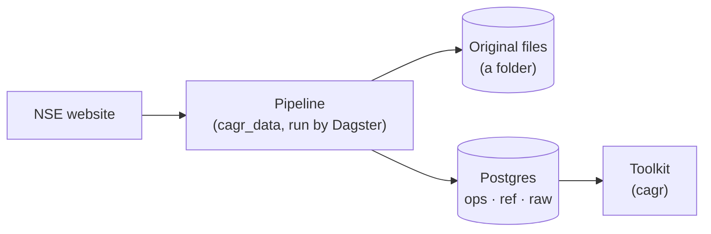

# Overview

**In short:** one repository with two Python packages. `cagr_data` (the platform) fetches and stores
market data. `cagr` (the toolkit) is a library of shared calculations. Both use one Postgres
database.

## Repository layout

| Folder | What it holds |
|---|---|
| `platform/` | The data platform package, `cagr_data` |
| `toolkit/` | The shared library, `cagr` |
| `db/migrations/` | Numbered SQL files that create every table |
| `docs/` | These pages, and `docs/specs/` for plans |
| `.github/workflows/` | CI |

The repository is a [uv](https://docs.astral.sh/uv/) workspace on Python 3.12, with one lock file
(`uv.lock`) for both packages.

## The platform: `cagr_data`

| Module | Job |
|---|---|
| `vendors` | Talks to NSE: the HTTP client and one parser per file type |
| `raw` | Fetches a file, saves it, records a receipt and loads its rows |
| `quality` | Checks each file and records the results |
| `reference` | Builds the trading calendar |
| `orchestration` | Dagster assets, schedules and the backfill command |
| `core` | Settings, database connections, migrations, file storage |

Dagster only schedules and calls these modules. The real work is in plain Python, tested without
Dagster.

## The toolkit: `cagr`

Indicators, metrics, session arithmetic, train/test splits, feature declarations and read-only
database access. See [Toolkit](../toolkit/README.md).

**Rule:** the toolkit never imports the platform. A test enforces it.

## Where it runs today

| Part | Where |
|---|---|
| Pipeline | Arush's laptop |
| Database | Azure Postgres 17, database `cagr_test`, reached through an SSH tunnel |
| Original files | A folder on the laptop (`CAGR_RAW_ROOT`) |
| Dagster's own run history | `DAGSTER_HOME` on the laptop (not in Postgres) |
| CI | GitHub Actions, with a throwaway Postgres |

The production database `stockdb` is never touched.

## Database logins

| Login | Used by | Can |
|---|---|---|
| `cagr_platform` | Migrations | Create and change tables |
| `cagr_writer` | The pipeline | Add data; never edit or delete raw data |
| `cagr_read` | The toolkit | Read only |

## Principles

- **Raw data is never edited.** If NSE re-publishes a file, the new one is stored next to the old.
- **Every row can be traced** to the file it came from and the run that fetched it.
- **Settings are data.** Feeds and check thresholds are rows in the database, not code.
- **Numbers stay exact.** Prices are stored as decimals; nothing is rounded or filtered.
