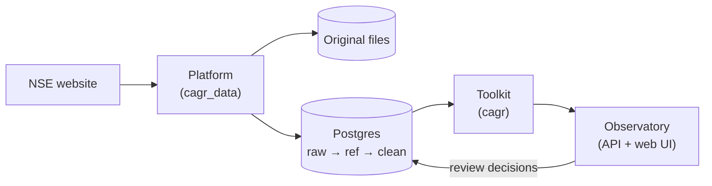

# Overview

**In short:** one repository with three Python packages and a web UI. `cagr_data` (the platform)
fetches market data and builds listings and clean bars. `cagr` (the toolkit) is a library of
shared calculations. `cagr_observatory` is the web app's API, with a React UI. All of them use one
Postgres database.

## Repository layout

| Folder | What it holds |
|---|---|
| `platform/` | The data platform package, `cagr_data` |
| `toolkit/` | The shared library, `cagr` |
| `observatory/api/` | The web app's Python API, `cagr_observatory` |
| `observatory/web/` | The web app's React UI (TypeScript) |
| `db/migrations/` | Numbered SQL files that create every table |
| `db/seeds/` | One-off data files, such as the industry seed |
| `docs/` | These pages, and `docs/specs/` for plans |
| `.github/workflows/` | CI |

The Python side is a [uv](https://docs.astral.sh/uv/) workspace on Python 3.12, with one lock file
(`uv.lock`) for all three packages. The UI uses npm.

## The platform: `cagr_data`

| Module | Job |
|---|---|
| `vendors` | Talks to NSE: the HTTP client and one parser per file type |
| `raw` | Fetches a file, saves it, records a receipt, loads its rows; packs old files into archives |
| `quality` | Checks each file and records the results |
| `reference` | Trading calendar, listings, corporate actions, price adjustments, shares outstanding, industry, review decisions |
| `clean` | Daily, weekly and monthly bars per listing |
| `orchestration` | Dagster assets, schedules and the backfill command |
| `core` | Settings, database connections, migrations, file storage |

Dagster only fetches files. Listings and clean bars are built by commands you run after the files
are in (see [NSE daily pipeline](../pipeline/nse-daily.md#after-the-files-build-listings-and-bars)).

## The toolkit: `cagr`

Indicators, metrics, session arithmetic, train/test splits, feature declarations and read-only
database access. See [Toolkit](../toolkit/README.md).

## The Observatory

A web app on `localhost`. Today it has one page, **Review**, where a person approves or rejects
what the rules couldn't decide. See [Observatory](../observatory/README.md).

## Rules between the parts

- The toolkit never imports the platform or the Observatory.
- The Observatory reads through the toolkit, and records decisions through the platform's review
  module.
- The web UI only talks to the API, never to the database.

Tests enforce the first rule.

## Where it runs today

| Part | Where |
|---|---|
| Pipeline and builds | Arush's laptop |
| Observatory | Arush's laptop, on `localhost` only |
| Database | Azure Postgres 17, database `cagr_test`, reached through an SSH tunnel |
| Original files | A folder on the laptop (`CAGR_RAW_ROOT`) |
| Dagster's own run history | `DAGSTER_HOME` on the laptop (not in Postgres) |
| CI | GitHub Actions, with a throwaway Postgres |

The production database `stockdb` is never touched.

## Database logins

| Login | Used by | Can |
|---|---|---|
| `cagr_platform` | Migrations | Create and change tables |
| `cagr_writer` | The pipeline and builds | Add data, rebuild `ref` and `clean`; never edit raw rows |
| `cagr_read` | The toolkit and the Observatory | Read only |
| `cagr_reviewer` | The Observatory's review page | Record a decision on a pending item, nothing else |

## Principles

- **Raw data is never edited.** If NSE re-publishes a file, the new one is stored next to the old.
- **Every row can be traced** to the file it came from and the run that fetched it.
- **Rules first, people second.** The builders decide what they can; anything uncertain waits for
  a person on the review page, and nothing guesses.
- **Settings are data.** Feeds and check thresholds are rows in the database, not code.
- **Numbers stay exact.** Raw prices are stored as decimals; nothing is rounded or filtered.
