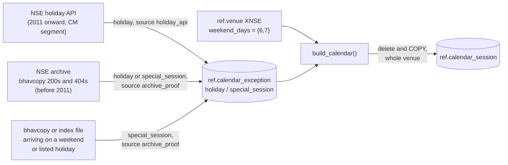
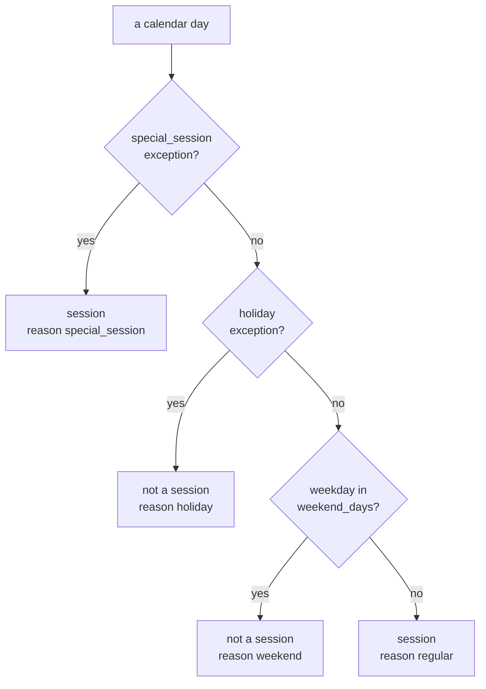

# Trading calendar (XNSE)

The calendar says, for every calendar day from **1 January 2010** to 31 December of next year,
whether NSE's capital market held a session, and numbers the sessions densely. It lives in
`ref.calendar_session`, is built by `cagr_data.reference.calendar`, and is read by the toolkit
through `cagr.db.load_calendar`.

## Inputs



Exceptions come from three places:

1. **The holiday API** (`holiday_exceptions`). Each holiday-master file loaded adds its `CM`
   holidays, with the file as `source_file_id`.
2. **Archive proof for 2010** (`record_archive_proof`, run by the `xnse_calendar` asset). The API
   has no list for 2010, so the archive decides, from the legacy bhavcopy fetches before 2011:
   - a weekday that got only a 404, lying between the first and last days that had a file, is a
     **holiday** (the bounds stop tonight's not-yet-published file from looking like a holiday);
   - a weekend day that had a file is a **special session**.
3. **Arrivals** (`raw.ingest._arrival`). When a bhavcopy or index file arrives on a weekend day or
   a listed holiday, that date is recorded as a special session. This is how sessions the holiday
   list does not know about (Muhurat trading, a Sunday Budget session) enter the calendar.

Exceptions are insert-only (`ON CONFLICT DO NOTHING`): a fact already recorded is never changed.

## Rules

`build_calendar` classifies each day in this order:



- A special session wins over a holiday on the same date (Muhurat trading on Diwali).
- A listed holiday that falls on a weekend gets reason `holiday`, not `weekend`.

## Numbering and period ends

- `session_index` counts sessions from 1 on the first session after 1 January 2010, with no gaps,
  so a window of N sessions is an index range. Because one new exception early on shifts every
  index after it, `refresh_calendar` always rebuilds the venue's whole calendar in one transaction
  (delete, then COPY).
- `is_week_end` marks the last session of each ISO week and `is_month_end` the last session of each
  month. At the end of the range a session is only flagged if its week or month also ends inside
  the range, so a calendar that stops on a Wednesday does not call that Wednesday a week end.

Example (June 2024, from the trial backfill: 17 Jun was a listed holiday):

| Date | Day | `is_session` | `reason` | `is_week_end` | `is_month_end` |
|---|---|---|---|---|---|
| 2024-06-14 | Fri | true | regular | true | false |
| 2024-06-15 | Sat | false | weekend | false | false |
| 2024-06-16 | Sun | false | weekend | false | false |
| 2024-06-17 | Mon | false | holiday | false | false |
| 2024-06-18 | Tue | true | regular | false | false |
| 2024-06-28 | Fri | true | regular | true | true |

## When it is rebuilt

The `xnse_calendar` Dagster asset runs after `nse_holidays` (Mondays at 07:00 IST, and once in
every backfill). It records archive proof for dates before 2011, then rebuilds the calendar to
31 December of next year. See [NSE daily pipeline](../pipeline/nse-daily.md).

## Reading it

From SQL:

```sql
SELECT date, session_index
  FROM ref.calendar_session
 WHERE venue_id = 'XNSE' AND is_session AND date BETWEEN '2024-06-01' AND '2024-06-30';
```

From Python, the toolkit's `Calendar` does session arithmetic on it; see
[Toolkit](../toolkit/README.md#cagrcalendar).
