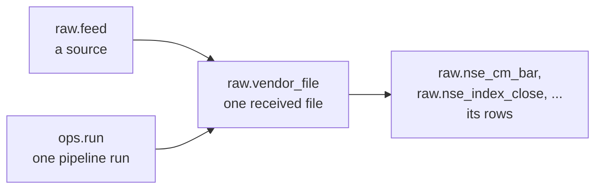

# Database

**In short:** Postgres 17 with four schemas, and data flows from one to the next: `raw` (NSE's
data as received), then `ref` (listings, calendar, corporate actions, industry), then `clean`
(bars and market cap). `ops` records runs and check results. Every table is created by the SQL
files in [`db/migrations/`](../../db/migrations).

## Schemas

| Schema | Holds | Details |
|---|---|---|
| `raw` | What NSE sent: every request, every file received, every row in those files | [Data sources](sources.md) |
| `ref` | Reference data: the calendar, listings, corporate actions, price adjustments, shares outstanding, industry | [Calendar](calendar.md), [Listings](listings.md), [Industry](industry.md) |
| `clean` | Bars per listing, adjusted and unadjusted, and market cap | [Clean bars](clean-bars.md) |
| `ops` | Pipeline runs, the list of checks, and check results | [Data quality](../pipeline/data-quality.md) |

## How raw data is traced

Every row points to the file it came from, and every file points to the run that fetched it.

## Tables

### `raw`

| Table | One row per |
|---|---|
| `vendor` | Website we download from |
| `feed` | Source file type, with URL template, dates and priority |
| `fetch_attempt` | HTTP request, including "not found" answers and errors |
| `vendor_file` | File received, with its hash, size, storage path and revision number |
| `nse_cm_bar` | Stock and series per day (prices, volume, value) |
| `nse_index_close` | Index per day |
| `nse_mcap` | Security per day: shares outstanding and market cap (from Feb 2024) |
| `nse_index_issue_cap` | Index member per index per day: shares outstanding (2010 to 2013) |
| `nse_corporate_action` | Row of a corporate-actions response |
| `nse_holiday` | Holiday per segment, from each holiday list |
| `nse_equity_list` | Listed company in each daily snapshot |
| `nse_etf_list` | ETF in each daily snapshot |
| `nse_symbol_change` | Symbol change in each daily snapshot |

`nse_cm_bar` is split into one partition per year, 2010 to 2030.

### `ref`

| Table | One row per |
|---|---|
| `venue` | Exchange (only `XNSE`: Asia/Kolkata, 09:15 to 15:30, Saturday and Sunday off) |
| `calendar_exception`, `calendar_session` | Holiday or special session; calendar day |
| `listing` | Security, for its whole life |
| `listing_symbol`, `listing_isin` | Symbol or ISIN a listing had, with dates |
| `listing_change` | Change to a listing: applied, pending, rejected or out of scope |
| `index_alias` | Old index name and the current name it maps to |
| `corporate_action` | Parsed corporate action |
| `price_adjustment` | Price adjustment, applied, pending, rejected or out of scope |
| `listing_shares` | Period of a listing's shares outstanding |
| `industry`, `listing_industry`, `industry_change` | Industry; a listing's industry; every assignment |
| `listing_tier` | NSE index tier period (empty for now) |
| `tracked_listing` | Listing the platform tracks: an EQ-series main-board equity or a listed index |

### `clean`

| Table | One row per |
|---|---|
| `bar_1d` | Listing per trading day (partitioned by year, 2010 to 2030) |
| `bar_1w`, `bar_1mo` | Listing per week or month |
| `adjustment_step` | Period of a listing's cumulative adjustment factor |

### `ops`

| Table | One row per |
|---|---|
| `run` | Pipeline or build run: kind, status, start and finish time |
| `dq_check` | Check, with its severity and thresholds |
| `dq_result` | Check result |

## Views and functions to use

| Use | Gives |
|---|---|
| `raw.nse_cm_bar_current`, `raw.nse_index_close_current`, ... | Raw rows from one file per day. Where NSE has two files (both price formats in early 2024, or a re-published file), the preferred one, latest revision |
| `ref.listing_current` | Every listing with its current symbol and ISIN |
| `ref.tracked_current` | What we track, with each listing's current symbol and ISIN and why it's tracked |
| `ref.listings_as_of(date)` | Listings on a date, with that day's symbol and ISIN |
| `ref.listing_by_symbol(symbol, date)` | The listing that held a symbol on a date |
| `ref.listing_classification(date)` | Each listing's industry, sector index and tier |
| `clean.bar_1d_adjusted`, `clean.bar_1d_unadjusted` | Daily bars, adjusted or as traded |
| `clean.market_cap_1d` | Daily shares and market cap |

## Who can do what

| Login | Can |
|---|---|
| `cagr_platform` | Owns everything. Used only for migrations |
| `cagr_writer` | Pipeline and builds: add raw rows (never edit them), rebuild `ref` and `clean`, record runs and results |
| `cagr_read` | Read everything |
| `cagr_reviewer` | Observatory's review page: read the review tables, and record a decision on a pending item. When a merge is approved, move that listing's symbols and ISINs. It can't add or delete rows |

## Migrations

| File | Does |
|---|---|
| `0001_ops.sql` | Creates the `ops` schema |
| `0002_ref_calendar.sql` | Creates the venue and calendar tables |
| `0003_raw.sql` | Creates the `raw` schema, its yearly partitions and the `_current` views |
| `0004_seed_xnse.sql` | Adds NSE, its first seven feeds and twelve raw checks |
| `0005_writer_maintain.sql` | Lets the pipeline refresh statistics on `nse_cm_bar` after a load |
| `0006_ohlc_t0.sql` | Relaxes one check for series T0 |
| `0007_ref_listings.sql` | Listings, symbols, ISINs, changes, corporate actions, price adjustments, and their checks |
| `0008_reviewer.sql` | Grants `cagr_reviewer` what the review page needs |
| `0009_corporate_actions.sql` | Corporate-actions and ETF-list feeds and their raw tables |
| `0010_clean.sql` | Creates the `clean` schema, bars, adjustment steps, views and checks |
| `0011_market_cap.sql` | PR zip feeds, share periods, the market cap view and checks |
| `0012_raw_archive.sql` | Lets the pipeline point a receipt at a monthly archive |
| `0013_industry.sql` | The 52 industries, assignments, tiers and their checks |

Never edit a migration that has run. Make a new one instead.
