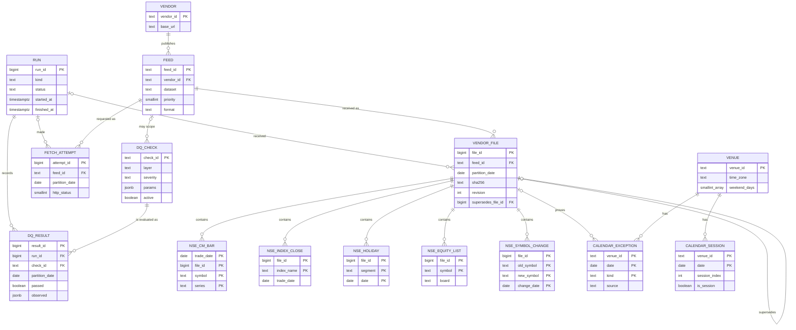
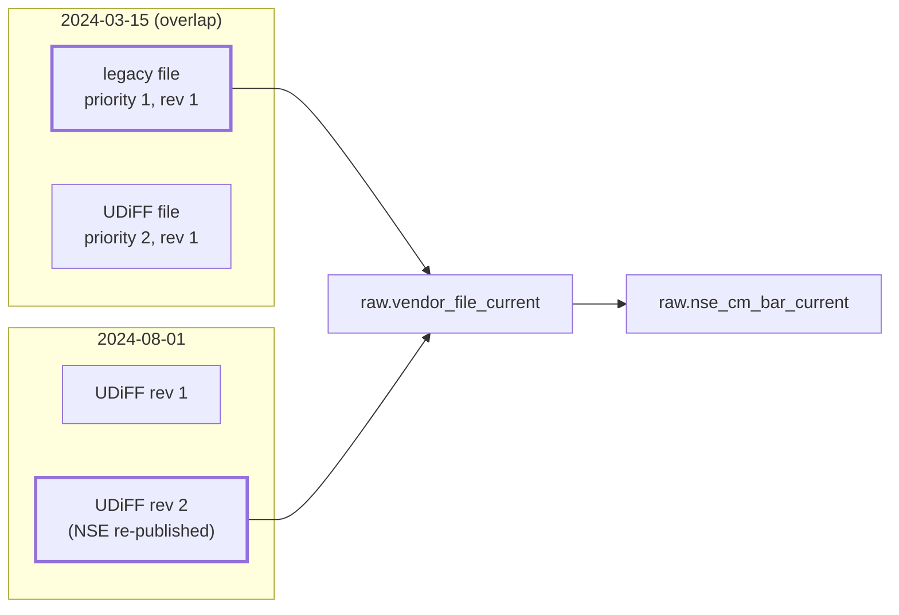

# Database

The platform's database is PostgreSQL 17 (the `cagr_test` database during the build). Every object
in it is created by the numbered SQL files in [`db/migrations/`](../../db/migrations), applied in
order by yoyo (`python -m cagr_data.core.migrate`). Nothing is created by hand and no extension is
used.

## Schemas

| Schema | Holds | Written by | Migration |
|---|---|---|---|
| `ops` | Pipeline runs and data-quality check definitions and results | `cagr_writer` | 0001 |
| `ref` | Venues and the trading calendar | `cagr_writer` (calendar only) | 0002 |
| `raw` | What vendors sent, as received: vendors, feeds, fetch attempts, file receipts and parsed rows | `cagr_writer` (insert only) | 0003 |
| `yoyo` | yoyo's own migration bookkeeping | `cagr_platform` | created by `core.migrate` |

`public` is not used (on Azure it belongs to `azure_pg_admin`).

## Entity relationships

Entity names drop the schema: `RUN`, `DQ_CHECK`, `DQ_RESULT` are in `ops`; `VENUE`,
`CALENDAR_EXCEPTION`, `CALENDAR_SESSION` in `ref`; the rest in `raw`.

## `ops` schema

### `ops.run`

One row per pipeline run (one per Dagster asset execution), so every receipt and check result says
which run made it.

| Column | Type | Notes |
|---|---|---|
| `run_id` | bigint identity | PK |
| `dagster_run_id` | text | Dagster's run id |
| `kind` | text | `nightly`, `backfill`, `revision_check` or `manual` |
| `started_at` | timestamptz | default `now()` |
| `finished_at` | timestamptz | null while running; `>= started_at` |
| `status` | text | `running`, `succeeded` or `failed`; `running` exactly when `finished_at` is null |
| `code_version` | text | from `CAGR_CODE_VERSION` if set |
| `peak_mem_mb` | integer | `>= 0`; not filled yet |

### `ops.dq_check`

Check definitions are data; thresholds live in `params`, not in code. Seeded by 0004 and 0006.
The full list is in [Data quality](../pipeline/data-quality.md).

| Column | Type | Notes |
|---|---|---|
| `check_id` | text | PK, lower snake case |
| `layer` | text | `raw`, `ref`, `clean`, `features` or `serve` (only `raw` is used today) |
| `feed_id` | text | FK `raw.feed`, optional |
| `severity` | text | `critical`, `warn` or `info` |
| `description`, `owner_action` | text | what it checks and what to do when it fails |
| `params` | jsonb | an object |
| `active` | boolean | inactive checks are not recorded |

### `ops.dq_result`

One row per check outcome. Indexed on `(check_id, partition_date)` and on `run_id`.

| Column | Type | Notes |
|---|---|---|
| `result_id` | bigint identity | PK |
| `run_id` | bigint | FK `ops.run` |
| `check_id` | text | FK `ops.dq_check` |
| `partition_date` | date | the session or snapshot date |
| `passed` | boolean | |
| `observed` | jsonb | counts, samples of offending keys, thresholds used |
| `detail` | text | error text when parsing failed |
| `checked_at` | timestamptz | default `now()` |

## `ref` schema

### `ref.venue`

| Column | Type | Value for XNSE (seeded in 0004) |
|---|---|---|
| `venue_id` | text, ISO 10383 MIC | `XNSE` |
| `name` | text | National Stock Exchange of India |
| `time_zone` | text | `Asia/Kolkata` |
| `weekend_days` | smallint[] (ISO, 1 = Monday) | `{6,7}` |
| `regular_open`, `regular_close` | time | 09:15, 15:30 |

### `ref.calendar_exception`

The facts the calendar is built from. Insert only; a fact already recorded is kept.

| Column | Type | Notes |
|---|---|---|
| `venue_id`, `date`, `kind` | | PK; `kind` is `holiday` or `special_session` (a date can hold both, e.g. Muhurat trading on Diwali) |
| `description` | text | from the holiday list |
| `source` | text | `holiday_api` or `archive_proof` |
| `source_file_id` | bigint | FK `raw.vendor_file` |
| `recorded_at` | timestamptz | |

### `ref.calendar_session`

One row per calendar day, derived from the venue and its exceptions and rebuilt whole by code.
See [Trading calendar](calendar.md).

| Column | Type | Notes |
|---|---|---|
| `venue_id`, `date` | | PK |
| `is_session` | boolean | |
| `session_index` | integer | dense count of sessions from 1 Jan 2010, unique per venue; null on non-sessions |
| `reason` | text | `regular`, `weekend`, `holiday` or `special_session` |
| `is_week_end`, `is_month_end` | boolean | last session of its ISO week / month |

Constraints keep it consistent: `is_session` exactly when `session_index` is set and exactly when
the reason is `regular` or `special_session`; only sessions can be week or month ends.

## `raw` schema

Append-only: the writer role may insert but never update or delete. Every parsed row points at the
`raw.vendor_file` it came from.

### `raw.vendor`, `raw.feed`

Described in [Data sources](sources.md). `raw.feed` is unique on `(dataset, priority)`.

### `raw.fetch_attempt`

Every HTTP request, including 404s and network failures. Indexed on `(feed_id, partition_date)`.

| Column | Type | Notes |
|---|---|---|
| `attempt_id` | bigint identity | PK |
| `run_id` | bigint | FK `ops.run` |
| `feed_id` | text | FK `raw.feed` |
| `partition_date` | date | |
| `url` | text | |
| `http_status` | smallint | at least one of `http_status`, `error` is set |
| `error` | text | exception type and message, first 1000 characters |
| `elapsed_ms` | integer | |
| `attempted_at` | timestamptz | |

### `raw.vendor_file`

A receipt for every distinct file received, written in the same transaction as its rows.

| Column | Type | Notes |
|---|---|---|
| `file_id` | bigint identity | PK |
| `feed_id` | text | FK `raw.feed` |
| `partition_date` | date | the session date, or the snapshot date |
| `url` | text | where it came from |
| `sha256` | text | 64 hex characters |
| `bytes` | bigint | `> 0` |
| `storage_uri` | text | where the original bytes are kept (`file://...` today) |
| `received_at` | timestamptz | |
| `run_id` | bigint | FK `ops.run` |
| `revision` | integer | 1 for the first file of a feed and date, then 2, 3, ... |
| `supersedes_file_id` | bigint | FK to the previous revision; null exactly when revision is 1 |
| `row_count` | integer | rows parsed from the file |

Unique on `(feed_id, partition_date, revision)` and on `(feed_id, partition_date, sha256)`, so the
same bytes are never received twice.

### `raw.nse_cm_bar`

Equity bhavcopy rows, both formats. Primary key `(trade_date, file_id, symbol, series)`. Column
mapping is in [Data sources](sources.md#bhavcopy-vendorsnsebhavcopypy). Checks in the table:
ISIN matches `^[A-Z]{2}[A-Z0-9]{9}[0-9]$`; volume, traded value and trade count are non-negative.

**Partitioned by range on `trade_date`**, one partition per calendar year,
`raw.nse_cm_bar_2010` to `raw.nse_cm_bar_2030` (21 partitions). There is no default partition: a row
outside them fails loudly. Partitions are created by migrations, never by the pipeline.

### `raw.nse_index_close`

Primary key `(file_id, index_name)`, indexed on `trade_date`. Columns: `trade_date`, `index_name`,
`open`, `high`, `low`, `close`, `points_change`, `pct_change`, `volume`, `turnover_inr` (crores, as
sent), `pe`, `pb`, `div_yield`.

### `raw.nse_holiday`

Primary key `(file_id, segment, date)`. Columns: `segment`, `date`, `description`, `weekday`.

### `raw.nse_equity_list`

Primary key `(file_id, symbol)`. Columns: `snapshot_date`, `board` (`main` or `sme`), `symbol`,
`name`, `series`, `listing_date`, `paid_up_value`, `market_lot`, `isin`, `face_value`.

### `raw.nse_symbol_change`

Primary key `(file_id, old_symbol, new_symbol, change_date)`. Columns: `snapshot_date`,
`company_name`, `old_symbol`, `new_symbol`, `change_date`.

## Views

| View | Returns |
|---|---|
| `raw.vendor_file_current` | For each `(dataset, partition_date)`, the one file read downstream: the feed with the lowest priority number, and its latest revision. Adds a `dataset` column to `raw.vendor_file`'s columns. |
| `raw.nse_cm_bar_current` | Bar rows of the current file per date only. |
| `raw.nse_index_close_current` | Index-close rows of the current file per date only. |

Both files of an overlap date stay in `raw.nse_cm_bar`; the `_current` views pick one per date. The
dates in this picture are illustrative.

## Roles and privileges

The three roles exist on the server already; the migrations only grant. The default privileges on
`cagr_test` give `cagr_writer` full DML on new tables, so each migration revokes and re-grants
explicitly.

| Object | `cagr_writer` | `cagr_read` |
|---|---|---|
| `ops.run` | SELECT, INSERT, UPDATE | SELECT |
| `ops.dq_check` | SELECT | SELECT |
| `ops.dq_result` | SELECT, INSERT | SELECT |
| `ref.venue` | SELECT | SELECT |
| `ref.calendar_exception` | SELECT, INSERT | SELECT |
| `ref.calendar_session` | SELECT, INSERT, UPDATE, DELETE | SELECT |
| `raw.vendor`, `raw.feed`, views | SELECT | SELECT |
| `raw.fetch_attempt`, `raw.vendor_file`, `raw.nse_*` row tables | SELECT, INSERT | SELECT |
| `raw.nse_cm_bar` and each partition | + MAINTAIN (PostgreSQL 17) | |

`MAINTAIN` (migration 0005) lets the pipeline `ANALYZE raw.nse_cm_bar` after each bulk load:
autovacuum never analyses a partitioned parent, and only its owner may unless granted MAINTAIN. On
a server older than 17 the migration does nothing and the writer's ANALYZE only warns.

`cagr_platform` owns every schema and is used only to apply migrations.

## Migrations

| File | Depends on | What it does |
|---|---|---|
| `0001_ops.sql` | | Schema `ops`: `run`, `dq_check`, `dq_result`, and grants |
| `0002_ref_calendar.sql` | 0001 | Schema `ref`: `venue`, `calendar_exception`, `calendar_session`, and grants |
| `0003_raw.sql` | 0002 | Schema `raw`: vendors, feeds, attempts, receipts, row tables, 2010..2030 bar partitions, views; adds the foreign keys from `ops.dq_check` and `ref.calendar_exception`; insert-only grants |
| `0004_seed_xnse.sql` | 0003 | Seeds venue XNSE, the two vendors, seven feeds and twelve raw checks |
| `0005_writer_maintain.sql` | 0004 | Grants MAINTAIN on the bar table and its partitions (PostgreSQL 17 only) |
| `0006_ohlc_t0.sql` | 0005 | Exempts series `T0` from the close part of `ohlc_order` |

How to apply them is in [Running the platform](../operations/running.md#apply-migrations).
