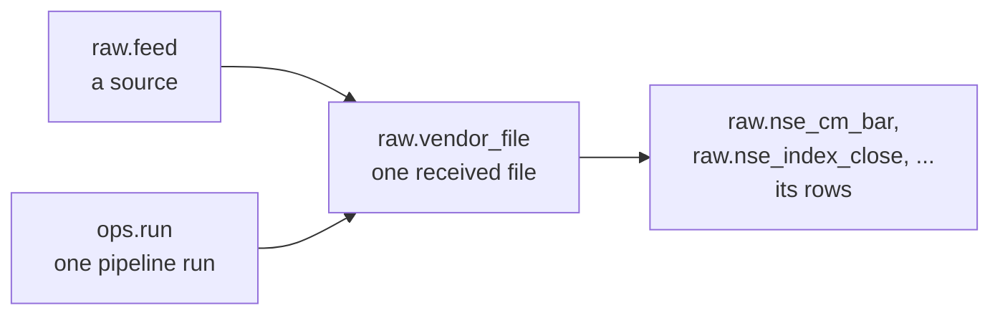

# Database

**In short:** Postgres 17 with three schemas. `raw` holds NSE's data exactly as received, `ref` holds
the trading calendar, and `ops` records pipeline runs and check results. Every table is created by
the SQL files in [`db/migrations/`](../../db/migrations).

## Schemas

| Schema | Holds |
|---|---|
| `raw` | What NSE sent: every request, every file received, and every row in those files |
| `ref` | The venue (NSE) and its trading calendar |
| `ops` | Pipeline runs, the list of checks, and check results |

## How raw data is traced

Every row points to the file it came from, and every file points to the run that fetched it.

## Tables

### `raw`

| Table | One row per |
|---|---|
| `vendor` | Website we download from |
| `feed` | Source file type, with URL template, dates and priority |
| `fetch_attempt` | HTTP request, including "not found" answers and errors |
| `vendor_file` | File received, with its hash, size, storage path and revision number |
| `nse_cm_bar` | Stock and series per day (prices, volume, value) |
| `nse_index_close` | Index per day |
| `nse_holiday` | Holiday per segment, from each holiday list |
| `nse_equity_list` | Listed company in each daily snapshot |
| `nse_symbol_change` | Symbol change in each daily snapshot |

`nse_cm_bar` is split into one partition per year, 2010 to 2030.

### `ref`

| Table | One row per |
|---|---|
| `venue` | Exchange (only `XNSE`: Asia/Kolkata, 09:15 to 15:30, Saturday and Sunday off) |
| `calendar_exception` | Holiday or special session |
| `calendar_session` | Calendar day (see [Trading calendar](calendar.md)) |

### `ops`

| Table | One row per |
|---|---|
| `run` | Pipeline run: kind, status, start and finish time |
| `dq_check` | Check, with its severity and thresholds (see [Data quality](../pipeline/data-quality.md)) |
| `dq_result` | Check result for one file or day |

## Use the `_current` views

NSE sometimes has two files for one day: both price formats in early 2024, or a re-published file.
All of them are kept. The views pick one file per day, so you don't have to:

| View | Gives |
|---|---|
| `raw.vendor_file_current` | One file per dataset and day: the preferred feed, latest revision |
| `raw.nse_cm_bar_current` | Price rows from that file only |
| `raw.nse_index_close_current` | Index rows from that file only |

Query the views, not the tables, unless you need every version.

## Who can do what

| | `cagr_writer` (pipeline) | `cagr_read` (toolkit) |
|---|---|---|
| `raw` tables | read, add rows | read |
| `ref.calendar_exception` | read, add rows | read |
| `ref.calendar_session` | read, rewrite | read |
| `ops.run` | read, add, update | read |
| `ops.dq_result` | read, add rows | read |
| `ref.venue`, `raw.feed`, `ops.dq_check` | read | read |

`cagr_platform` owns everything and is used only for migrations.

`cagr_reviewer` is the Observatory's review page. It reads the review tables and can only record
a decision on a pending item: the decision columns of `ref.listing_change` and
`ref.price_adjustment`, and the columns an approved merge changes in `ref.listing`,
`ref.listing_symbol` and `ref.listing_isin`. It can't add or delete rows anywhere.

## Migrations

| File | Does |
|---|---|
| `0001_ops.sql` | Creates the `ops` schema |
| `0002_ref_calendar.sql` | Creates the `ref` schema |
| `0003_raw.sql` | Creates the `raw` schema, its yearly partitions and the `_current` views |
| `0004_seed_xnse.sql` | Adds NSE, its seven feeds and the twelve checks |
| `0005_writer_maintain.sql` | Lets the pipeline refresh statistics on `nse_cm_bar` after a load |
| `0006_ohlc_t0.sql` | Relaxes one check for series T0 |
| `0008_reviewer.sql` | Grants `cagr_reviewer` what the review page needs to record decisions |

Never edit a migration that has run. Make a new one instead.
