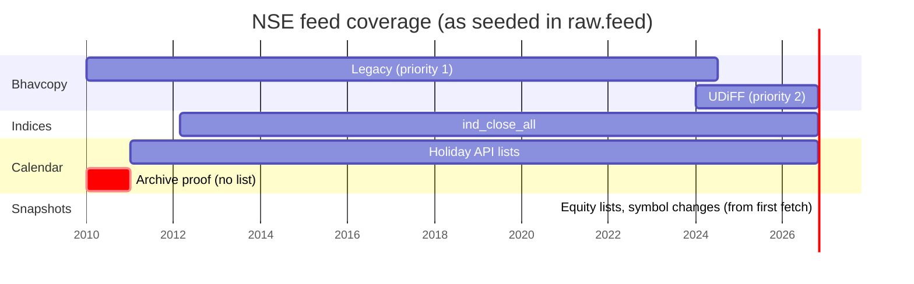

# Data sources

Every source the platform reads today is published by the National Stock Exchange of India (NSE).
Sources are described as rows, not code: vendors in `raw.vendor` and feeds in `raw.feed`, both
seeded by migration `0004_seed_xnse.sql`. Each feed's file format maps to one parser in
`cagr_data.raw.feeds.FORMATS`.

## Vendors

| `vendor_id` | Base URL | `rate_limit_per_s` (recorded) |
|---|---|---|
| `nse_archives` | `https://nsearchives.nseindia.com` | 2 |
| `nse_api` | `https://www.nseindia.com` | 1 |

The rate the pipeline actually uses comes from the Dagster resource `NseClient`
(`rate_limit_per_s = 1.0`, one request a second per host); the column above is recorded but not read
by code yet.

## Feeds

| `feed_id` | Dataset | Priority | Format | Cadence | Available | Target table |
|---|---|---|---|---|---|---|
| `nse_cm_bhavcopy_legacy` | `nse_cm_bhavcopy` | 1 | `legacy_v1` | session | 2010-01-01 to 2024-07-05 | `raw.nse_cm_bar` |
| `nse_cm_bhavcopy_udiff` | `nse_cm_bhavcopy` | 2 | `udiff_v1` | session | 2024-01-01 onward | `raw.nse_cm_bar` |
| `nse_index_close` | `nse_index_close` | 1 | `ind_close_all_v1` | session | 2012-02-21 onward | `raw.nse_index_close` |
| `nse_holidays` | `nse_holidays` | 1 | `holiday_master_v1` | weekly | 2011 onward | `raw.nse_holiday` |
| `nse_equity_list` | `nse_equity_list` | 1 | `equity_l_v1` | daily | current snapshot | `raw.nse_equity_list` (board `main`) |
| `nse_sme_equity_list` | `nse_sme_equity_list` | 1 | `sme_equity_l_v1` | daily | current snapshot | `raw.nse_equity_list` (board `sme`) |
| `nse_symbol_change` | `nse_symbol_change` | 1 | `symbolchange_v1` | daily | current snapshot | `raw.nse_symbol_change` |

- **Dataset and priority.** Two feeds can serve one dataset. Where both have a file for a date, the
  lower priority number is the one read downstream (see `raw.vendor_file_current` in
  [Database](database.md#views)). For bhavcopy, legacy (1) wins over UDiFF (2) during their overlap.
- **Cadence.** `session` feeds publish one file per calendar day and are partitioned by date.
  `daily` and `weekly` feeds are snapshots, stored under the date they were fetched (the holiday
  list under 1 January of its year).
- **Available.** A feed is only requested for dates inside `available_from`..`available_to`
  (`cagr_data.raw.fetch.feeds_for`).

### Coverage over time

Bhavcopy has both formats from 1 Jan to 5 Jul 2024. A source check on that overlap found the two
formats identical on every row of 5 Jul 2024; the trial backfill found them equal on close, volume,
prices, value and trade count for all 24 shared sessions in June and July 2024
(see [`specs/0001-acceptance.md`](../specs/0001-acceptance.md)).

## URL templates

Templates are filled by `cagr_data.vendors.nse.urls.build_url` with `{YYYY}`, `{MM}`, `{DD}`
(zero padded) and `{MON}` (`JAN` .. `DEC`).

| Feed | URL template |
|---|---|
| Legacy bhavcopy | `https://nsearchives.nseindia.com/content/historical/EQUITIES/{YYYY}/{MON}/cm{DD}{MON}{YYYY}bhav.csv.zip` |
| UDiFF bhavcopy | `https://nsearchives.nseindia.com/content/cm/BhavCopy_NSE_CM_0_0_0_{YYYY}{MM}{DD}_F_0000.csv.zip` |
| Index closes | `https://nsearchives.nseindia.com/content/indices/ind_close_all_{DD}{MM}{YYYY}.csv` |
| Holidays | `https://www.nseindia.com/api/holiday-master?type=trading&year={YYYY}` |
| Main-board equities | `https://nsearchives.nseindia.com/content/equities/EQUITY_L.csv` |
| SME equities | `https://nsearchives.nseindia.com/emerge/corporates/content/SME_EQUITY_L.csv` |
| Symbol changes | `https://nsearchives.nseindia.com/content/equities/symbolchange.csv` |

Requests to `nse_api` add `Referer: https://www.nseindia.com/` and `Accept: application/json`.

## How each file is read

All NSE CSVs go through `cagr_data.vendors.nse.csvfile`: every field is read as text, header names
are stripped, a trailing comma's empty column is dropped, `""` and `"-"` mean missing, and each
column is cast once, strictly. A value that does not fit its column raises `FileShapeError` instead
of becoming a silent null. The parser also checks the header against the exact column list its
format expects.

### Bhavcopy (`vendors/nse/bhavcopy.py`)

Both formats come out with the same columns (those of `raw.nse_cm_bar`), so the loader does not care
which it got. Each download is a zip holding exactly one CSV.

| `raw.nse_cm_bar` column | UDiFF column | Legacy column | Type |
|---|---|---|---|
| `trade_date` | `TradDt` (`YYYY-MM-DD`) | `TIMESTAMP` (`DD-MON-YYYY`) | date |
| `symbol` | `TckrSymb` | `SYMBOL` | text |
| `series` | `SctySrs` (blank → `''`) | `SERIES` (blank → `''`) | text |
| `isin` | `ISIN` | `ISIN` (absent until 21 Jun 2011 → null) | text |
| `instrument_type` | `FinInstrmTp` | none → null | text |
| `open`, `high`, `low`, `close` | `OpnPric`, `HghPric`, `LwPric`, `ClsPric` | `OPEN`, `HIGH`, `LOW`, `CLOSE` | numeric(18,4) |
| `last` | `LastPric` | `LAST` (0 → null) | numeric(18,4) |
| `prev_close` | `PrvsClsgPric` | `PREVCLOSE` | numeric(18,4) |
| `volume` | `TtlTradgVol` | `TOTTRDQTY` | bigint |
| `traded_value_inr` | `TtlTrfVal` | `TOTTRDVAL` | numeric(22,2) |
| `trade_count` | `TtlNbOfTxsExctd` | `TOTALTRADES` (absent until 21 Jun 2011 → null) | bigint |
| `source_format` | `'udiff_v1'` | `'legacy_v1'` | text |

Format variants the parser accepts:

- **UDiFF:** until 20 Jun 2024 the reserved columns are named `Rsvd01`..`Rsvd04` and the header ends
  with a comma; from 21 Jun 2024 they are `Rsvd1`..`Rsvd4`. Old names are mapped to new ones.
- **Legacy:** an 11-column header (`SYMBOL` .. `TIMESTAMP`) until 21 Jun 2011 and a 13-column header
  (adding `TOTALTRADES`, `ISIN`) after. Every line ends with a comma. 2010 dates are not zero padded
  (`4-JAN-2010`).
- A legacy `last` of `0` (untraded bond rows) is stored as null, matching UDiFF's empty value.
- Every row's trade date must equal the partition date, or the file is rejected with
  `TradeDateMismatchError`.

Raw keeps every series and instrument the file has (EQ, BE, BZ, SM, ST, bonds, T0, ...).
Nothing is filtered.

### Index closes (`vendors/nse/index_close.py`)

Header: `Index Name, Index Date, Open Index Value, High Index Value, Low Index Value, Closing Index
Value, Points Change, Change(%), Volume, Turnover (Rs. Cr.), P/E, P/B, Div Yield`.

- `Index Date` is `DD-MM-YYYY` and must equal the partition date.
- Index names are kept exactly as sent; they change over the years (`S&P CNX Nifty`, `CNX Nifty`,
  `Nifty 50`).
- `turnover_inr` holds the file's value, which **is in crores** as the header says; it is not
  converted.

### Holidays (`vendors/nse/holidays.py`)

The API returns JSON keyed by segment (`CM`, `FO`, `CD`, ...), each a list of
`{tradingDate: "DD-Mon-YYYY", weekDay, description, ...}`. Raw keeps every segment; the calendar
reads only `CM`. The parser rejects dates outside the requested year, a `weekDay` that disagrees
with the date, and duplicate dates within a segment. For 2010 the API answers `{}`, which means
"no list", not "no holidays"; that is why the calendar starts its holiday list in 2011 and uses
archive proof before it (see [Trading calendar](calendar.md)).

### Listings (`vendors/nse/listings.py`)

These files have no date inside; the snapshot date is the day they were fetched.

| File | Board | Columns read | Date format |
|---|---|---|---|
| `EQUITY_L.csv` | `main` | symbol, name, series, listing date, paid-up value, market lot, ISIN, face value | `DD-MON-YYYY` |
| `SME_EQUITY_L.csv` | `sme` | same, without market lot (header uses `_` for spaces) | `DD-Mon-YY` |
| `symbolchange.csv` | n/a | company name, old symbol, new symbol, effective date | `DD-MON-YYYY` |

Each `symbolchange.csv` snapshot holds the full history of changes. Turning these into listings with
validity dates is spec 0002 and not built yet.
