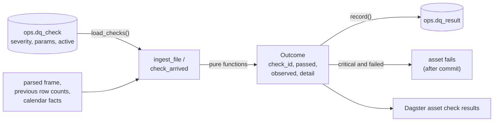
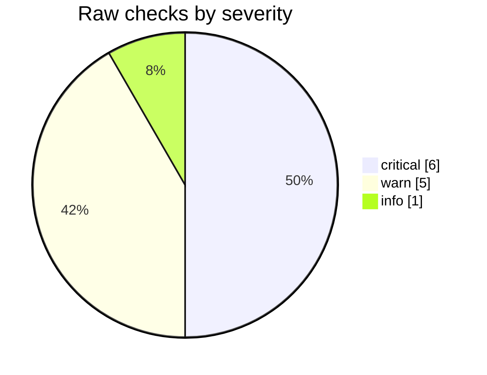

# Data quality

Every file the pipeline loads is checked before its run is called a success. Checks are defined as
rows in `ops.dq_check` (seeded by migrations 0004 and 0006), implemented as pure functions in
`cagr_data.quality.checks`, and recorded in `ops.dq_result` by `cagr_data.quality.runner`. All
twelve checks today are in the `raw` layer.

## How a check runs



- **Thresholds are data.** Each function receives its check's `params`, so tuning a check is an
  `UPDATE` on `ops.dq_check` in a migration, not a code change.
- **Inactive checks are skipped.** `record` writes a result only for active checks.
- **Results survive failure.** Results are written and committed before the asset raises on a
  critical failure, so a failed run still says why.
- **`observed`** holds the evidence: counts, the thresholds used, and up to 10 offending keys
  (`symbol/series` or index names).

## The checks

| Check | Severity | Applies to | Passes when | Params | If it fails |
|---|---|---|---|---|---|
| `file_arrived` | critical | each expected session, at 22:30 IST | a current file exists for each dataset in `datasets` that publishes that day | `deadline_ist: "22:30"`, `datasets: [nse_cm_bhavcopy, nse_index_close]` | Check the NSE archive by hand; rerun the partition once the file is there |
| `file_shape` | critical | every file | the parser accepted the header, column count and every value's type | | Block; the parser or the feed format needs an update |
| `trade_date_matches` | critical | bhavcopy, index close | every row's date equals the partition date | | Block; look at the URL template and the file |
| `no_duplicates` | critical | bhavcopy, index close | one row per `(symbol, series)` / per `index_name` | | Block; inspect the file |
| `row_count` | critical | bhavcopy | `\|rows − median\| ≤ max(median × 10%, 50)` over the previous 20 current files | `lookback_sessions: 20`, `max_pct_diff: 10`, `min_abs_diff: 50` | Block; compare with the NSE archive before rerunning |
| `benchmark_present` | critical | index close | at least one of the names is in the file | `index_names: ["Nifty 50", "S&P CNX Nifty", "CNX Nifty"]` | Block; inspect the file |
| `holiday_session` | warn | bhavcopy, index close | the day is not a listed holiday | | A special session is recorded; confirm it was Muhurat trading or that NSE's list is wrong |
| `prices_positive` | warn | bhavcopy | open, high, low, close are all > 0 on rows with volume > 0 | | Flag for the clean layer |
| `ohlc_order` | warn | bhavcopy | `low ≤ open ≤ high` and `low ≤ close ≤ high`; for exempt series only the open | `close_exempt_series: ["T0"]` | Flag for the clean layer |
| `isin_present` | warn | bhavcopy | every row of the listed series has an ISIN, from the given date | `from: "2011-06-22"`, `series: ["EQ"]` | List the rows; spec 0002 maps them |
| `vendor_revision` | warn | every file | the file is revision 1 | | Revision stored; check what changed |
| `special_session` | info | bhavcopy, index close | the day is not a weekend day that is unlisted as a holiday | | Recorded as a special session |



### Notes on individual checks

- **`file_shape` and `trade_date_matches`** come from what the parser raised: `FileShapeError` fails
  `file_shape`; `TradeDateMismatchError` passes `file_shape` and fails `trade_date_matches`. When
  parsing fails no receipt, rows or stored file are written; only the results are.
- **`row_count`** skips (passes with `skipped`) when there are no previous files. Previous counts
  come from `raw.vendor_file_current`, so in the 2024 overlap they are the legacy file's counts.
- **`ohlc_order`** exempts `T0` (NSE's same-day settlement series) from the close part since
  migration 0006: T0 reports the normal segment's closing price as its close, which can sit
  outside T0's own high and low. The trial backfill found 6 such rows in June to August 2024.
- **`holiday_session` and `special_session`** run when a session file arrives. Either one failing
  also records the day as a special session in `ref.calendar_exception`
  (see [Trading calendar](../data-model/calendar.md)). Neither blocks.
- **`file_arrived`** is evaluated by the `nse_session_complete` asset only when the calendar says
  the day is a session and the 22:30 IST deadline has passed. Datasets that do not publish on the
  day (index closes before 21 Feb 2012) are not expected.
- **`isin_present`** passes with `skipped` before its `from` date (legacy files had no ISIN column
  until 21 Jun 2011).

## Querying results

Failures in the last week:

```sql
SELECT r.partition_date, r.check_id, c.severity, r.observed, r.detail
  FROM ops.dq_result r
  JOIN ops.dq_check c USING (check_id)
 WHERE NOT r.passed AND r.checked_at > now() - interval '7 days'
 ORDER BY r.partition_date, c.severity, r.check_id;
```

Pass rate per check over a backfill:

```sql
SELECT check_id, count(*) FILTER (WHERE passed) AS passed, count(*) AS total
  FROM ops.dq_result r
  JOIN ops.run USING (run_id)
 WHERE kind = 'backfill'
 GROUP BY check_id
 ORDER BY check_id;
```
