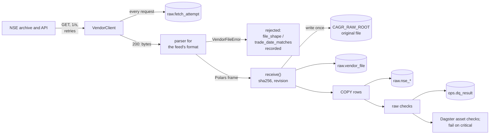
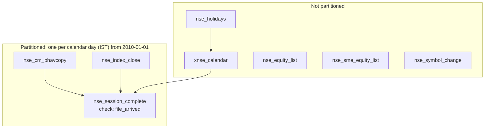
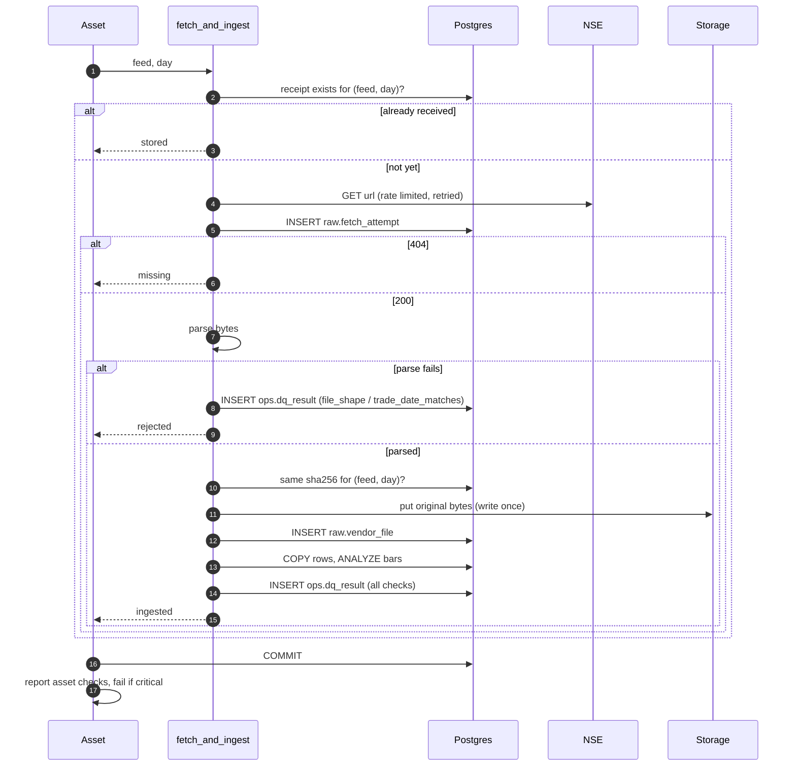
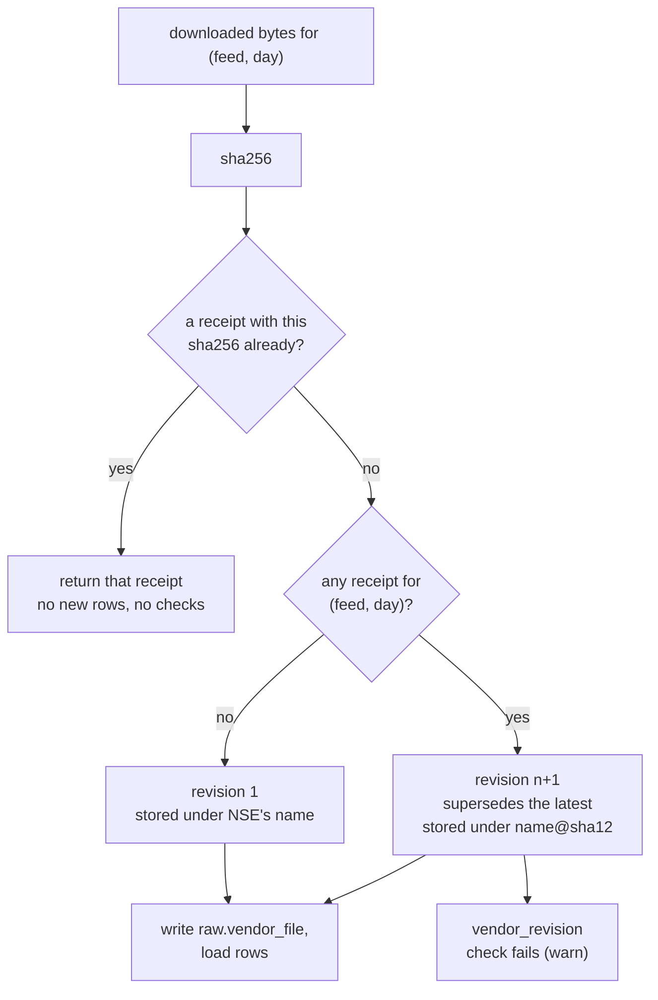
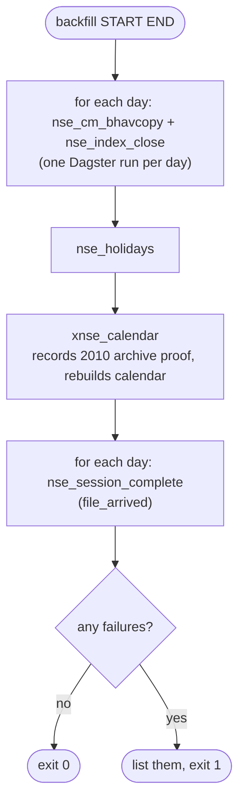

# NSE daily pipeline

The pipeline downloads NSE's daily files, keeps the original bytes, loads every row into the `raw`
schema exactly as sent, checks each file, and keeps the trading calendar current. It is
orchestrated by [Dagster](https://dagster.io/); all the real work is in plain modules that are
tested without Dagster.

## End-to-end flow

The receipt, its rows and the check results are written in **one transaction** per file, so a
receipt never exists without its rows.

## Assets

All assets are in Dagster group `nse` (`cagr_data/orchestration/assets.py`).

| Asset | Partitioned | Feeds fetched | Writes | Asset checks |
|---|---|---|---|---|
| `nse_cm_bhavcopy` | daily | every active bhavcopy feed for the day (both in the 2024 overlap) | `raw.nse_cm_bar` | 10 (see below) |
| `nse_index_close` | daily | `nse_index_close` (from 21 Feb 2012) | `raw.nse_index_close` | 7 |
| `nse_session_complete` | daily | none | `ops.dq_result` | `file_arrived` |
| `nse_holidays` | no | `nse_holidays` for every year from 2011 to next year | `raw.nse_holiday`, `ref.calendar_exception` | `file_shape`, `vendor_revision` |
| `xnse_calendar` | no | none | `ref.calendar_exception` (archive proof), `ref.calendar_session` | none |
| `nse_equity_list` | no | `nse_equity_list` | `raw.nse_equity_list` | `file_shape`, `vendor_revision` |
| `nse_sme_equity_list` | no | `nse_sme_equity_list` | `raw.nse_equity_list` | `file_shape`, `vendor_revision` |
| `nse_symbol_change` | no | `nse_symbol_change` | `raw.nse_symbol_change` | `file_shape`, `vendor_revision` |

Asset checks per asset:

| Check | `nse_cm_bhavcopy` | `nse_index_close` | snapshots, holidays | `nse_session_complete` |
|---|:-:|:-:|:-:|:-:|
| `file_shape` | ● | ● | ● | |
| `trade_date_matches` | ● | ● | | |
| `no_duplicates` | ● | ● | | |
| `row_count` | ● | | | |
| `benchmark_present` | | ● | | |
| `holiday_session` | ● | ● | | |
| `special_session` | ● | ● | | |
| `prices_positive` | ● | | | |
| `ohlc_order` | ● | | | |
| `isin_present` | ● | | | |
| `vendor_revision` | ● | ● | ● | |
| `file_arrived` | | | | ● |

Checks marked critical (`file_shape`, `trade_date_matches`, `no_duplicates`, `row_count`,
`benchmark_present`, `file_arrived`) are **blocking** Dagster checks with severity ERROR; the rest
are WARN. A check that did not run (no file that day, file already stored) is reported as passed
with `evaluated: false` and the reason. If several feeds ran for one day (the 2024 overlap), a
check passes only if it passed for each.

### Partitions

`DailyPartitionsDefinition(start_date="2010-01-01", timezone="Asia/Kolkata", end_offset=1)`: one
partition per calendar day, **including weekends**, because NSE has traded on days a weekday rule
misses. `end_offset=1` makes today's partition available in the evening. A 404 on a non-session day
is the expected answer, not an error.

### Run kinds

Every asset execution opens an `ops.run` row and closes it as `succeeded` or `failed`.

| Kind | When |
|---|---|
| `backfill` | Runs tagged `cagr/run_kind=backfill` (the backfill command) or launched as a Dagster backfill |
| `nightly` | Other runs of the session assets |
| `manual` | Holiday lists and listing snapshots |
| `revision_check` | Allowed by the schema; not used by any asset yet |

## Schedules

Defined in `cagr_data/orchestration/definitions.py`, all in `Asia/Kolkata`.

| Schedule | Job | Assets | Cron (IST) |
|---|---|---|---|
| `nse_session_evening` | `nse_session` | `nse_cm_bhavcopy`, `nse_index_close`, `nse_session_complete` | `0,30 19-22 * * *`, today's partition; skips after 22:30 |
| `xnse_calendar_weekly_schedule` | `xnse_calendar_weekly` | `nse_holidays`, `xnse_calendar` | `0 7 * * 1` (Mondays 07:00) |
| `nse_snapshots_schedule` | `nse_snapshots` | the three listing snapshots | `30 7 * * *` (daily 07:30) |

The `schedule_cron` column in `raw.feed` is descriptive; Dagster's schedules above are what run.

```mermaid
gantt
    title One evening for today's partition (IST)
    dateFormat HH:mm
    axisFormat %H:%M
    section Scheduled runs
    19.00 :r1, 19:00, 5m
    19.30 :r2, 19:30, 5m
    20.00 :r3, 20:00, 5m
    20.30 :r4, 20:30, 5m
    21.00 :r5, 21:00, 5m
    21.30 :r6, 21:30, 5m
    22.00 :r7, 22:00, 5m
    22.30 :crit, r8, 22:30, 5m
    section What happens
    Fetch only what is still missing :active, w1, 19:00, 210m
    file_arrived decided at the deadline :crit, w2, 22:30, 15m
```

Each run is idempotent: a feed that already has a receipt for the day is not downloaded again, so
later runs only fetch what is still missing. `nse_session_complete` only evaluates `file_arrived`
when the calendar says the day is a session **and** it is 22:30 IST or later; before that it reports
the reason it did not evaluate.

## Fetching

`cagr_data.vendors.http.VendorClient` is the one HTTP client:

- a browser user agent and `Accept: */*`, 30 s timeout, redirects followed;
- a per-host rate limiter (thread-safe), one request a second by default from the `NseClient`
  resource;
- up to 5 attempts with exponential back-off (2 s multiplier, 60 s cap) on network errors and on
  HTTP 403, 429, 500, 502, 503, 504 (NSE's bot protection answers 403);
- a **404 is returned immediately as an answer**: on NSE's archive it means "no file for that day".

`cagr_data.raw.fetch.fetch_and_ingest` does one feed for one day:

A network failure after the last retry is recorded in `raw.fetch_attempt` with its error, then
raised, which fails the step and marks the run `failed`.

## Receipts and revisions

`cagr_data.raw.receipts.receive` decides what a downloaded file is:

New bytes are only requested again when a fetch is asked to do a revision check. Today that
happens for the holiday lists of this year and next year, every week.

## Original file storage

`cagr_data.core.storage.LocalStorage` writes files under `CAGR_RAW_ROOT`. Files are write-once: the
same bytes under a key is a no-op, different bytes under a used key raise `StorageConflictError`.
Writes go to a temporary file first and are hard-linked into place, so a half-written file is never
visible.

Keys are `{vendor}/{feed_id}/{YYYY}/{MM}/{file name}` (`raw_key`); the vendor folder for both NSE
vendors is `nse`.

| Feed cadence | Stored name | Example |
|---|---|---|
| session | NSE's file name | `nse/nse_cm_bhavcopy_udiff/2024/07/BhavCopy_NSE_CM_0_0_0_20240708_F_0000.csv.zip` |
| daily snapshot | name with `_YYYYMMDD` before the extension | `nse/nse_equity_list/2026/10/EQUITY_L_20261027.csv` |
| holiday list | `holiday-master_trading_{YYYY}.json` under 1 January | `nse/nse_holidays/2026/01/holiday-master_trading_2026.json` |
| revision 2+ | `@` and the first 12 hex characters of the sha256 before the first dot | `.../ind_close_all_08072024@<sha256[:12]>.csv` |

The `storage_uri` in `raw.vendor_file` is the file's `file://` URI.

## Loading rows

`cagr_data.raw.loaders.load_rows` streams the parsed Polars frame into its table with `COPY ...
FROM STDIN`, adding the receipt's `file_id` to every row. It only accepts the five raw row tables.
Loading the same file twice fails on the primary key rather than duplicating rows. After a bar load
it runs `ANALYZE raw.nse_cm_bar` (see [Database](../data-model/database.md#roles-and-privileges)).

## Backfill

`python -m cagr_data.orchestration.backfill START END` (`orchestration/backfill.py`) runs the
assets in-process over a date range, in the order the calendar needs:

- Every run is tagged `cagr/run_kind=backfill` and `cagr/backfill=START..END`. With `DAGSTER_HOME`
  set, runs are recorded there and show up in `dagster dev`.
- Already-received days are skipped, so a backfill can be rerun safely after a failure.
- If a run fails and the database is unreachable (the laptop's tunnel dropped), it polls the
  database every 15 s for up to 30 minutes and retries that partition, up to 3 attempts, instead of
  failing every remaining day.
- It reads `.env` from the current folder.

At one request a second a year of session files takes roughly 12 minutes of requests. The trial
over June to August 2024 finished in 15 minutes with no failures
([acceptance notes](../specs/0001-acceptance.md)).

How to run it is in [Running the platform](../operations/running.md#run-a-backfill).
