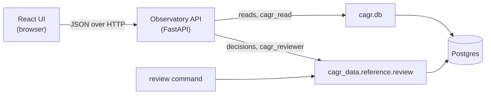

# Spec 0005: the Observatory, starting with the review page

| | |
|---|---|
| Status | Agreed. Arush answered the open questions on 27 Oct 2026 (section 9). |
| Date | 2026-10-27 |
| Owner | Arush |
| Component | `observatory/`: Python API (`cagr-observatory`) and React UI, version 0.1.0 |
| Database | `cagr_test` |
| Depends on | Spec 0002 (the review queue in `ref.listing_change` and `ref.price_adjustment`), spec 0004 (`cagr.db`) |

## In one minute

- The Observatory is **the platform's web app**: a Python API and a TypeScript/React UI in
  `observatory/`. It is rebuilt from nothing. The old Observatory in `aif-model` is a reference only.
- Its **first page is Review**: the corporate actions and listing changes the rules couldn't
  decide (spec 0002, section 7.4). A person sees why each item is waiting and approves or rejects it.
- **It reads through the toolkit** (`cagr.db`, read-only). **Decisions go through the platform's
  review module**, the same code the command line uses, with a login that can do only that.
- It runs on Arush's laptop for now, on `localhost`. The VM comes later.

## 1. Goal

Every item that is waiting for a person can be decided in under a minute, from one page, without
opening a terminal or a database client. The page shows the evidence in words first, then one
chart, then two buttons.

When this step is done:

- The pending list is visible, oldest first, with how many sessions each item has waited.
- Each item says in one sentence why the rules stopped, for example *"The close fell 50.2% on the
  ex-date. A 1:1 bonus predicts 50%. NSE's announcement was missing, so a person must confirm."*
- Approve, reject (with a note) and merge work, and are recorded with who and when.
- Decided items stay visible under History.

## 2. Scope

### In scope

| What | Why now |
|---|---|
| `observatory/api`: FastAPI app, package `cagr_observatory` in the uv workspace | Every later page needs it |
| `observatory/web`: React, TypeScript and Vite, built into static files the API serves | Same |
| The Review page: queue, item detail, decide, history | Arush's answer 6: it comes first |
| A `cagr_reviewer` login that can only record decisions | Writes stay controlled (section 5) |
| CI for the web app (type-check, lint, tests, build) | Checks on every PR |

### Out of scope (later specs)

- Every other page: strategies, backtests, analytics, the formula editor, industry indices.
- Sign-in and roles for more people (Q2). Teams cards for review items.
- Running on the VM, HTTPS and a domain.
- Editing a factor by hand on the page (Q3).

## 3. Who uses it

| Who | Does |
|---|---|
| Arush | Clears the queue after the nightly run |
| A second reviewer (later) | The same. D16 then lets one propose and the other approve |

## 4. The Review page

### 4.1 Layout

```
┌───────────────────────────────────────────────────────────────────────────┐
│ Observatory   Review (7)   …later pages                                   │
├──────────────────────────┬────────────────────────────────────────────────┤
│ Waiting (7)  History     │ KAUSHALYA · price adjustment · ex 06 Feb 2024   │
│                          │                                                │
│ Price adjustments (5)    │ The close jumped ×100 on the ex-date and the   │
│  KAUSHALYA  ×100   4 ses │ ISIN changed. No NSE announcement matches.     │
│  GRASIM     0.99   1 ses │                                                │
│ Listing changes (2)      │  Proposed factor   100      Observed   99.6    │
│  4021 → 377? merge 2 ses │  Close before      0.42     Close on   41.85   │
│                          │  ISIN              INE…01 → INE…02             │
│                          │                                                │
│                          │  [ chart: closes 20 sessions either side,      │
│                          │    unadjusted and adjusted with this factor ]  │
│                          │                                                │
│                          │  Note ____________________                     │
│                          │  [ Approve ]  [ Reject ]                        │
└──────────────────────────┴────────────────────────────────────────────────┘
```

- **Left:** the queue, in two groups, oldest first. An item waiting more than three sessions is
  marked, matching the `review_waiting` check (spec 0002, section 8).
- **Right:** the selected item. Words first, then the numbers, then one chart, then the decision.
- Keyboard: `j`/`k` to move, `a` to approve, `r` to reject.

### 4.2 What each kind of item shows

| Item | The sentence, the numbers | The chart |
|---|---|---|
| Price adjustment with an action | NSE's subject text, the parsed kind and ratio, expected and observed factor, how far apart they are | Closes 20 sessions either side of the ex-date, unadjusted and adjusted with the proposed factor. A correct factor makes the adjusted line continuous |
| Price adjustment without an action | The jump, the nearest clean ratio, whether the ISIN changed | Same |
| Demerger or capital reduction | The factor taken from prices, and the subject text | Same |
| Listing change (new ISIN on an old symbol, unknown index name) | Old and new values, the rule that stopped, the file and the `symbolchange.csv` row | None. A small table of each side's last and first sessions |
| Merge suggestion | The two listings side by side: symbols, ISINs, first and last sessions, gap in sessions | None |

Changed after the first real queue (27 Oct 2026, about 4,000 items): every item also says how to
decide its kind and what approve and reject write; listing changes get a chart of each listing's
closes; the queue gets a type filter, sort and search; and the chart counts the listing's own
bars, so a halt before the ex-date doesn't empty one side. The kinds are listed in
[docs/observatory](../observatory/README.md#the-kinds-of-item).

### 4.3 Decisions

| Button | What happens |
|---|---|
| Approve | `status = applied`, `decided_by`, `decided_at` and the note are set. An adjustment gets `applied_at`, and spec 0003 rebuilds that listing's bars on the next run |
| Reject | `status = rejected`. A note is required |
| Merge into… | Pick the survivor (search by symbol or ISIN). Writes a `merge` change row, as the command line does |

The database still enforces `decided_by <> proposed_by`. If the API refuses, the page says why in
plain words. Items the rules proposed carry `proposed_by = 'rules'`.

The page reads the evidence spec 0002 already stores, and recomputes nothing: `observed_factor`,
`expected_factor`, `close_before` and `close_on` on adjustments, the action's `subject`, and the
`evidence` keys on listing changes (`rule`, `session`, `file_ids`, `row`, `previous`,
`symbolchange`, `candidates`; spec 0002, section 6.1).

History lists decided items, newest first, filterable by kind and reviewer. Undo is a merge's
reverse change row only. A wrong applied factor is corrected the spec 0002 way: reject it, and a
new row with a higher id replaces it.

## 5. How it reads and writes



- **Reads** go through the toolkit's read-only connection (`CAGR_READ_DATABASE_URL`), as decided
  in spec 0004.
- **Decisions** call the platform's review module, the one behind `python -m
  cagr_data.reference.review`. The page and the command line share one code path, so they can't
  disagree on rules like D16.
- The module connects as **`cagr_reviewer`** (`CAGR_REVIEW_DATABASE_URL`). That login can update
  only the decision columns of the two queue tables and make the writes a merge needs. It can't
  touch raw data, bars or anything else.
- The UI never talks to the database. It calls the API only.

### 5.1 API

| Method and path | Returns or does |
|---|---|
| `GET /api/review/items?status=pending` | The queue, with kind, listing, dates, age in sessions and the one-line reason |
| `GET /api/review/items/{kind}/{id}` | Everything in 4.2 for one item, including the chart's closes |
| `POST /api/review/items/{kind}/{id}/approve` | `{note}` → the updated item |
| `POST /api/review/items/{kind}/{id}/reject` | `{note}` (required) → the updated item |
| `POST /api/review/merge` | `{merged_id, into_id, note}` → the new change row |
| `GET /api/listings/search?q=` | Listings by symbol, ISIN or name, for the merge picker |
| `GET /api/health` | Database reachable, migrations current |

`kind` is `adjustment` or `change`. Types are written once in Python (Pydantic) and generated into
TypeScript from the API's OpenAPI schema, so the UI can't drift from the API.

## 6. The code

```
observatory/
├── api/                        Python package cagr_observatory (uv workspace member)
│   ├── src/cagr_observatory/
│   │   ├── app.py              FastAPI app; serves web/dist in production
│   │   ├── settings.py         CAGR_* settings, including the reviewer name (Q2)
│   │   └── review/             routes, queries, the reason sentences
│   └── tests/
└── web/                        React + TypeScript + Vite
    ├── src/
    │   ├── api/                generated types and a small fetch client
    │   ├── pages/review/       queue, item, history
    │   └── components/
    └── package.json
```

| Choice | Why |
|---|---|
| FastAPI, Pydantic | Typed, small, and its OpenAPI schema generates the UI's types |
| React, TypeScript, Vite | Decided earlier. Vite needs no configuration to start |
| TanStack Query | Fetching, caching and refetch after a decision, without a state library |
| A small SVG line chart of our own (`components/LineChart.tsx`) | Lightweight Charts was tried first and dropped on 27 Oct 2026: a log scale, a marked date and labelled lines are simpler to get right in SVG. A charting library can come back for the candle pages |
| Plain CSS with variables | Few styles, light and dark themes, no framework to learn |
| npm | Ships with Node; one lock file in `observatory/web` |

The API imports `cagr` and `cagr_data.reference.review`. The toolkit still imports neither.

Running it:

```sh
uv run observatory              # API and built UI on http://localhost:8400
cd observatory/web && npm run dev   # UI with hot reload, calls the API above
```

## 7. How we know it works

- API tests against the test database: a fixture inserts pending items of every kind; approve,
  reject and merge change the right rows; a self-approval is refused; `cagr_reviewer` can't write
  anywhere else.
- UI tests (Vitest and Testing Library) on the item view for each kind in 4.2, against recorded
  API responses.
- One end-to-end run in a browser (Playwright): open the page, approve an item, see it move to
  History.
- Acceptance: Arush clears the real pending list from spec 0002 task 4 on the page.

## 8. Build slices

Each slice is one PR into main.

| # | What | Needs |
|---|---|---|
| O1 | Skeleton: `observatory/api` with `/api/health`, `observatory/web` with the app shell and an empty Review page, CI job for the web app | Nothing |
| O2 | Read side: queue and item APIs, the queue and item views, the chart | Spec 0002 migration 0007 (built meanwhile against fixtures with the same tables) |
| O3 | Decisions: migration 0008 (`cagr_reviewer`, after 0002's 0007), approve, reject, merge, History | The review module from spec 0002 task 5 |
| O4 | Acceptance on the real pending list with Arush; docs page `docs/observatory/` | 0002 task 4 |

## 9. Decisions (Arush, 27 Oct 2026)

| # | Question | Decision |
|---|---|---|
| Q1 | Record decisions straight away, or through an inbox the nightly pipeline applies? | Straight away, through the platform's review module and the `cagr_reviewer` login |
| Q2 | How does the page know who is deciding? | A setting, `CAGR_REVIEWER=arush`, while it runs only on the laptop. Sign-in (Microsoft) when it moves to the VM and a second reviewer joins |
| Q3 | Can a person type a different factor on the page? | No. Approve or reject only. A wrong factor is rejected and fixed from the command line |
| Q4 | Is one chart per item enough? | Yes |
