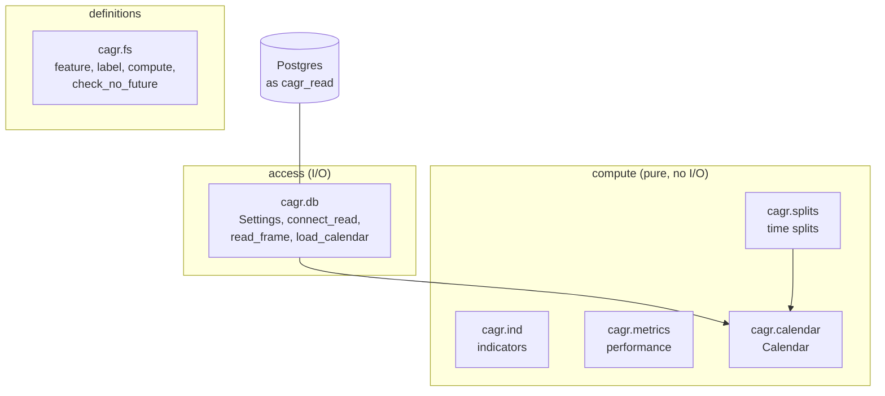
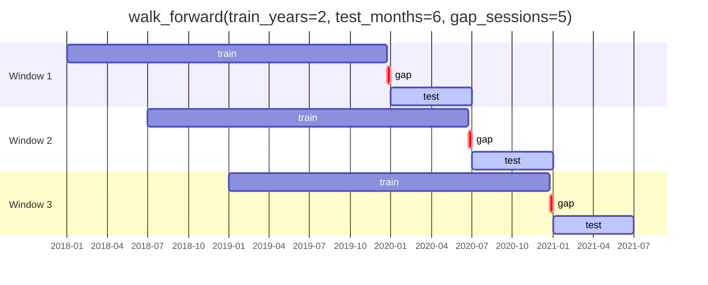
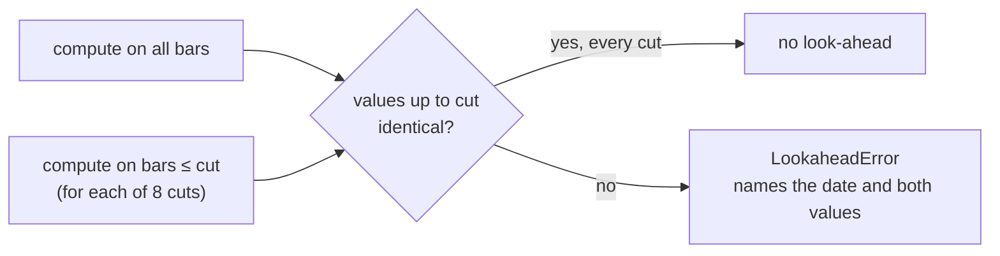

# Toolkit (`cagr`)

`cagr-toolkit` (imported as `cagr`, version 0.1.0) is the shared library every component imports:
the pipelines, the lab and later the Observatory call the same functions, so a number such as a
run's CAGR is the same everywhere. This is its first slice (spec 0004, slice T1).

```sh
uv run python -c "import cagr; print(cagr.__version__)"
```

## Layers



A lower layer never imports a higher one, and compute and definitions modules never import
`psycopg`, `httpx`, `duckdb` or `cagr.db`. The toolkit never imports the platform (`cagr_data`).
`toolkit/tests/test_cagr_layers.py` enforces all three by parsing the source.

All tabular inputs and outputs are [Polars](https://pola.rs/) frames, series or expressions.

---

## `cagr.ind`

Textbook indicators as **Polars expressions** over one listing's bars sorted by date (columns
`open`, `high`, `low`, `close`, `volume`). Run them per listing with `.over("listing_id")`, or
through `cagr.fs.compute`, which does that for you. Values are null until the window is full.

| Function | Default input | Definition |
|---|---|---|
| `sma(n, col="close")` | close | rolling mean over n bars |
| `ema(n, col="close")` | close | alpha = 2 / (n + 1), seeded with the SMA of the first n |
| `returns(n=1, col="close")` | close | x / x[n bars ago] − 1 |
| `rolling_high(n, col="high")` | high | highest of the last n bars, today included |
| `rolling_low(n, col="low")` | low | lowest of the last n bars, today included |
| `volume_mean(n, col="volume")` | volume | rolling mean of volume |
| `true_range()` | high, low, close | max(high − low, \|high − prev close\|, \|low − prev close\|); the range on bar one |
| `atr(n=14)` | | Wilder-smoothed true range |
| `atr_pct(n=14)` | | ATR / close × 100 |
| `rsi(n=14, col="close")` | close | Wilder RSI, 0 to 100; 100 when the window has no losses |
| `plus_di(n=14)`, `minus_di(n=14)` | high, low, close | smoothed directional movement / smoothed true range × 100, from bar two |
| `adx(n=14)` | | Wilder-smoothed DX, DX = 100 × \|+DI − −DI\| / (+DI + −DI) |
| `wilder(x, n)` | any expression | Wilder's average: first value is the mean of the first n, then prev + (x − prev) / n |

```python
import polars as pl
from cagr import ind

bars.with_columns(
    ind.rsi(14).over("listing_id").alias("rsi_14"),
    ind.atr_pct(14).over("listing_id").alias("atr_pct_14"),
)
```

## `cagr.metrics`

Performance analytics as **pure functions** that return numbers.

Conventions:

- An **equity curve** is a frame with a date column and a value column (defaults `date`, `equity`),
  one row per session, at least two rows, no missing values. It is sorted by date before use.
- **Cash flows** are a frame with `date` and `amount`: money put in is negative, money taken out
  (and the final value) is positive.
- **Returns** are simple period returns, as `curve_returns` produces.
- Years are actual days / 365.25 for CAGR and actual days / 365 for XIRR (as Excel does).
- Annualisation uses `TRADING_DAYS = 252` periods per year unless told otherwise.

| Function | Input | Returns |
|---|---|---|
| `total_return(curve)` | curve | last / first − 1 |
| `cagr(curve)` | curve | (last / first)^(1 / years) − 1; −1.0 if the curve ends at or below zero; raises if it starts at or below zero |
| `curve_returns(curve)` | curve | Series of period returns (one fewer than rows) |
| `drawdown(curve)` | curve | frame `date, peak, drawdown` (0 or negative) |
| `max_drawdown(curve)` | curve | deepest drawdown as a fraction (−0.25 = 25%); 0 if none |
| `max_drawdown_duration(curve)` | curve | most consecutive rows below a previous peak |
| `volatility(returns, periods_per_year=252)` | returns | sample std (ddof 1) × √periods |
| `sharpe(returns, risk_free=0.0, periods_per_year=252)` | returns | mean excess / std × √periods; NaN if std is 0. `risk_free` is annual, spread evenly |
| `sortino(returns, risk_free=0.0, periods_per_year=252)` | returns | mean excess / downside deviation × √periods; NaN if no downside |
| `xirr(flows)` | cash flows | annual rate where NPV = 0, by bisection; needs a negative and a positive flow |
| `hit_rate(pnl)` | trade P&L | share of trades > 0 (zero is not a hit) |
| `win_loss(pnl)` | trade P&L | `{avg_win, avg_loss, payoff}`; payoff = avg win / \|avg loss\| |
| `holding_days(trades)` | `entry_date`, `exit_date` | calendar days held per trade |

```python
from datetime import date
import polars as pl
from cagr import metrics

curve = pl.DataFrame({"date": [date(2020, 1, 1), date(2022, 1, 1)], "equity": [100.0, 121.0]})
metrics.cagr(curve)          # 0.0999... (731 days / 365.25 = 2.001 years)
metrics.max_drawdown(curve)  # 0.0
```

## `cagr.calendar`

`Calendar(sessions, venue="XNSE")` holds a venue's session dates and answers questions in
sessions, not weekdays. It does no I/O; `cagr.db.load_calendar` builds one from
`ref.calendar_session` (see [Trading calendar](../data-model/calendar.md)).

| Member | Returns |
|---|---|
| `first`, `last`, `len(cal)` | first and last session, number of sessions |
| `is_session(d)` | whether d is a session |
| `index(d)` | position of session d, 0 for the first; raises if d is not a session |
| `on_or_before(d)` / `on_or_after(d)` | nearest session on that side |
| `shift(d, n)` | the session n sessions after session d (before, for negative n) |
| `between(start, end)` | sessions from start to end, both included |
| `count(start, end)` | sessions after start up to and including end (1 from one session to the next) |

```python
from cagr.db import connect_read, load_calendar

cal = load_calendar(connect_read())
cal.shift(cal.on_or_before(date(2024, 6, 15)), 20)   # 20 sessions after the last session ≤ 15 Jun
```

## `cagr.splits`

Train / test splits **by time**, with a gap. Rows are split on a date column. The gap drops the
last `gap_sessions` sessions before each test window from training, so a label that looks n
sessions ahead cannot span both sides; set it to at least the label's horizon. Sessions come from a
`Calendar` when given, otherwise from the distinct dates in the frame.

| Function | What it yields |
|---|---|
| `holdout_by_date(ds, test_start, gap_sessions=...)` | one `Split`: everything before `test_start` less the gap trains; `test_start` onward tests |
| `walk_forward(ds, train_years=..., test_months=..., gap_sessions=..., step_months=None, expanding=False)` | rolling `Split`s; windows move by `step_months` (default `test_months`) |
| `expanding(ds, min_train_years=..., test_months=..., gap_sessions=...)` | like `walk_forward`, but training always starts at the first date |
| `random_split(ds, test_fraction, seed=0, allow_random=False)` | raises `RandomSplitError` unless `allow_random=True`: a random split leaks the future on time series |
| `add_months(d, months)` | d moved by whole months, clamped to month end (31 Jan + 1 = 28/29 Feb) |

A `Split` carries `train`, `test`, `train_start`, `train_end` (last training date after the gap),
`test_start`, `test_end`.



(Dates in the picture are illustrative; the gap is counted in sessions, not days.)

## `cagr.fs`

Features and labels: how they are declared, computed and checked for look-ahead.

A **feature** is a function that returns a Polars expression over one listing's bars. The
decorator records its name, version, inputs and warm-up:

```python
from cagr import fs, ind

@fs.feature(name="rsi_14", version=1, inputs=["close"], min_bars=15)
def rsi_14():
    return ind.rsi(14)

values = fs.compute(rsi_14, bars)          # columns: listing_id, date, rsi_14@1
fs.check_no_future(rsi_14, bars)           # raises LookaheadError if it peeks ahead
```

| Name | Does |
|---|---|
| `@feature(name, version, inputs, min_bars, asset_classes=("equity",), timeframe="1d")` | Declares a `Feature`. Name must be lower snake case, version ≥ 1, `min_bars` ≥ 1, inputs non-empty. |
| `@label(...)` | Same, but marks `uses_future=True`: labels look ahead by design. |
| `Feature.key` | `"{name}@{version}"`, the output column name |
| `Feature.code_hash` | sha256 of the function's source, so a changed function can't silently reuse a version |
| `compute(f, bars, by="listing_id", date_col="date")` | Sorts, runs the expression per listing, nulls the first `min_bars − 1` rows. Raises if an input column is missing. |
| `check_no_future(f, bars, cuts=8)` | Recomputes on history cut at up to 8 dates and compares with the full-history values; raises `LookaheadError` on any difference. Refuses labels. Returns the cut dates checked. |



Previewing and registering features against a lake are not built yet.

## `cagr.db`

Read-only access to the platform database. Writing belongs to the platform's pipelines.

| Name | Does |
|---|---|
| `Settings` | reads `CAGR_READ_DATABASE_URL` from the environment or `.env` |
| `connect_read(url=None)` | autocommit connection set to `READ ONLY` for the session, whatever the login; expects `cagr_read` |
| `read_frame(conn, query, params=None)` | runs a query and returns a Polars frame (empty with its columns when no rows) |
| `load_calendar(conn, venue="XNSE")` | a `Calendar` from `ref.calendar_session`; raises if the venue has no sessions |

```python
from cagr.db import connect_read, read_frame

with connect_read() as conn:
    bars = read_frame(conn, "SELECT * FROM raw.nse_cm_bar_current WHERE symbol = %s AND series = 'EQ'",
                      ("INFY",))
```

Bars read from `raw` today are unadjusted and keyed by symbol; adjusted bars keyed by listing are
spec 0003 and not built yet.
